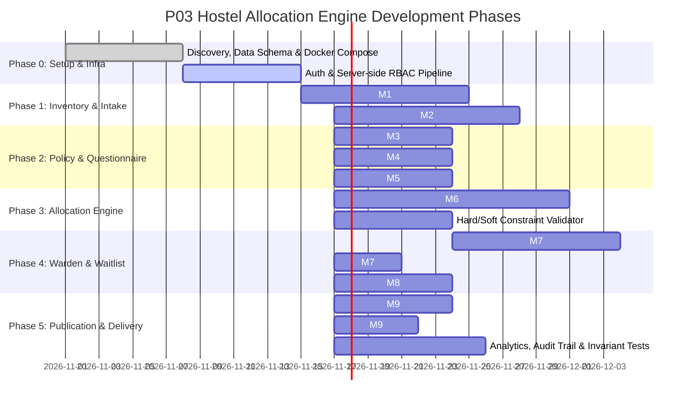

# Project P03: Tasks and Phases Roadmap
## Policy-Driven Hostel Allocation Engine with Roommate Compatibility Matching

**Stack**: Track J (Next.js 14 App Router, Node.js + Express, MongoDB Replica Set, BullMQ + Redis, Tailwind CSS)

---

## 📌 Milestone Overview & Delivery Schedule

---

## 📋 Detailed Task Breakdown by Phase

### Phase 0: Foundations & Architecture Baseline (Weeks 1–2)
- [x] Initialize Monorepo with `server` (Node/Express/TS) and `client` (Next.js/TS/Tailwind).
- [x] Configure `docker-compose.yml` with MongoDB 7 Replica Set (`rs0`) and Redis 7.
- [x] Establish AES-256-GCM encryption utilities for sensitive lifestyle data.
- [x] Define core Mongoose data schemas (User, Hostel, Block, Room, Bed, Cycle, Application, Preference, Questionnaire, Draft, Assignment, Waitlist, Audit).
- [x] Implement JWT authentication with `httpOnly` cookies and role-based access control (`STUDENT`, `WARDEN`, `CHIEF_WARDEN`, `HOSTEL_ADMIN`, `SYSADMIN`).
- [x] Connect and verify GitHub Actions CI workflow (linting, typechecks, build, tests).

---

### Phase 1: Inventory Management & Application Intake (Weeks 3–5)
#### Module M1: Hostel & Bed Inventory
- [ ] **M1.1**: Build CRUD endpoints for Hostels, Blocks, Floors, and Rooms (`/api/v1/inventory/*`).
- [ ] **M1.2**: Implement bed-level tracking with accessibility tags (`isAccessible`, attached washroom, AC).
- [ ] **M1.3**: Add CSV/Excel bulk import endpoint for loading thousands of rooms/beds at once.
- [ ] **M1.4**: Build admin UI screens for inventory visualization and capacity inspection.

#### Module M2: Allocation Cycles & Application Intake
- [ ] **M2.1**: Implement Cycle Manager (`/api/v1/cycles`) with window opening/closing dates, academic year, and quotas.
- [ ] **M2.2**: Build student application intake endpoint (`/api/v1/cycles/:id/apply`) with supporting document uploads.
- [ ] **M2.3**: Build mobile-friendly Next.js student application portal with step-by-step progress indicator.

---

### Phase 2: Policy Validation, Preferences & Lifestyle Matching (Weeks 6–7)
#### Module M3: Policy & Eligibility Engine
- [ ] **M3.1**: Create deterministic rule engine checking fee status, disciplinary holds, semester standing, and distance from campus.
- [ ] **M3.2**: Produce explicit, human-readable rejection/ineligibility reasons (no uninspected rejections).
- [ ] **M3.3**: Provide admin interface to configure and toggle eligibility criteria per cycle.

#### Module M4: Preference Capture
- [ ] **M4.1**: Create student preference ranking interface (rank top 3 hostels, preferred room type: single/double/triple).
- [ ] **M4.2**: Add optional mutual roommate request by student registration number.

#### Module M5: Lifestyle Questionnaire & Compatibility Scoring
- [ ] **M5.1**: Build consent-gated lifestyle survey (sleep habits, study hours, cleanliness standards, noise tolerance, smoking/social habits).
- [ ] **M5.2**: Encrypt raw student responses with AES-256-GCM before database persistence.
- [ ] **M5.3**: Implement normalized trait vector generation $(0.0 - 1.0)$ for fast computational scoring.
- [ ] **M5.4**: Implement pairwise compatibility metric:
  $$\text{Compatibility}(A, B) = \sum_{k} w_k \cdot (1 - |a_k - b_k|)$$
- [ ] **M5.5**: Write negative security tests asserting that no student can query another student's raw questionnaire answers.

---

### Phase 3: Deterministic Allocation Engine (Weeks 8–10)
#### Module M6: Background Allocation Worker (BullMQ + Redis)
- [ ] **M6.1**: Setup BullMQ queue `allocation-runs` with concurrency controls and progress tracking.
- [ ] **M6.2**: Implement Hard Constraint enforcement:
  - Gender segregation by hostel/block/floor.
  - Strict bed capacity (no room overfilled).
  - Accessibility assignment (students with accessibility needs matched to ground-floor/accessible rooms).
- [ ] **M6.3**: Implement Soft Constraint optimization:
  - Ranked preference satisfaction scoring.
  - Grouping compatible roommates using pairwise compatibility vectors.
- [ ] **M6.4**: Deterministic seeded tie-breaker using `seedrandom(cycle.randomSeed)` to ensure identical outputs on re-runs.
- [ ] **M6.5**: Persist output into `AllocationDraft` and `DraftAssignment` collections.
- [ ] **Governance Check**: Assert that the allocation worker *never* writes to `Bed.status` or `Bed.currentStudentId`.

---

### Phase 4: Warden Review Board & Waitlist Management (Weeks 11–12)
#### Module M7: Warden Review & Floor Bed Map
- [ ] **M7.1**: Develop interactive visual bed map per floor in Next.js showing draft student placements.
- [ ] **M7.2**: Implement manual drag-and-drop or select-to-reassign bed capability.
- [ ] **M7.3**: Enforce **mandatory written justification** for any warden reassignment before the override can be saved.
- [ ] **M7.4**: Log every override into the immutable `AuditEntry` collection.

#### Module M8: Waitlist Management
- [ ] **M8.1**: Automatically place unmatched eligible students onto an ordered `WaitlistEntry` queue based on merit/priority score.
- [ ] **M8.2**: Implement auto-promotion worker that offers beds to waitlisted students when vacancies arise.

---

### Phase 5: Publication, PDF Letters, Analytics & Handover (Weeks 13–14)
#### Module M9: Transactional Publication & Letter Generation
- [ ] **M9.1**: Build atomic publish action (`POST /api/v1/drafts/:id/publish`) wrapped in a MongoDB transaction:
  - Validates warden approval.
  - Updates live `Bed.status` to `OCCUPIED` and sets `currentStudentId`.
  - Marks cycle as `PUBLISHED`.
- [ ] **M9.2**: Generate downloadable PDF allocation letters (using PDFKit / server-side renderer) featuring student details, room assignment, QR code verification, and check-in dates.
- [ ] **M9.3**: Send automated email and in-app notifications on publication.

#### System Analytics & Reporting
- [ ] **M9.4**: Build admin occupancy heatmap and capacity analytics.
- [ ] **M9.5**: Build preference satisfaction reports (% of students receiving 1st vs 2nd choice) and warden override frequency reports.

#### Invariant & Property-Based Test Suite
- [ ] **Test 1**: Verify zero duplicate bed assignments under any load.
- [ ] **Test 2**: Verify zero double-assigned students.
- [ ] **Test 3**: Verify seed reproducibility (same seed + same applicants = identical draft).
- [ ] **Test 4**: Verify negative governance rule (saving draft never alters live bed occupancy).
- [ ] **Test 5**: Verify DPDP data privacy (lifestyle responses inaccessible to other students).

